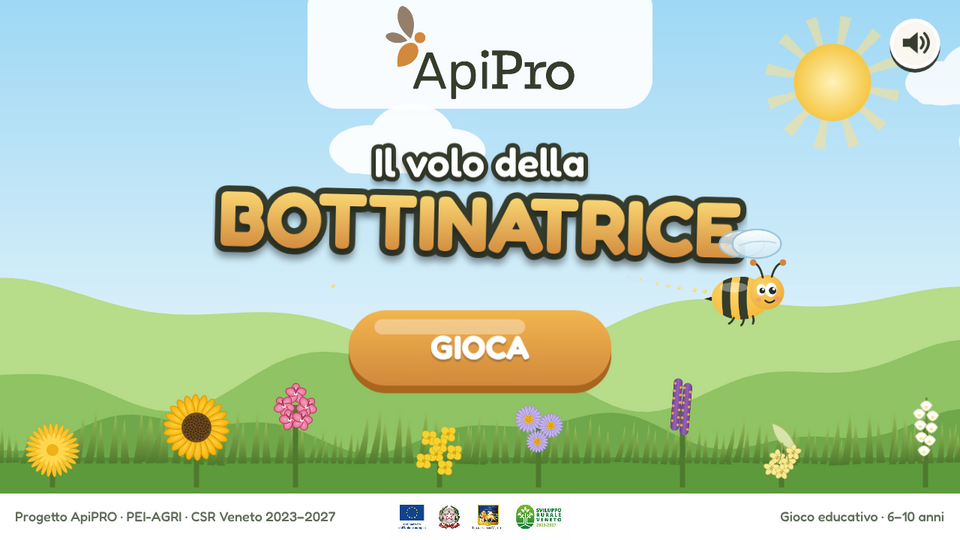
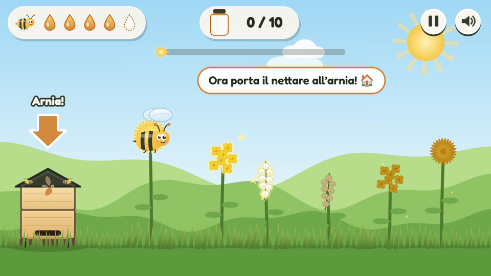
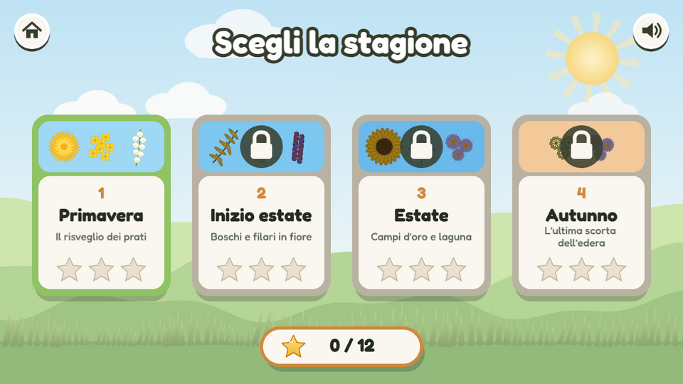
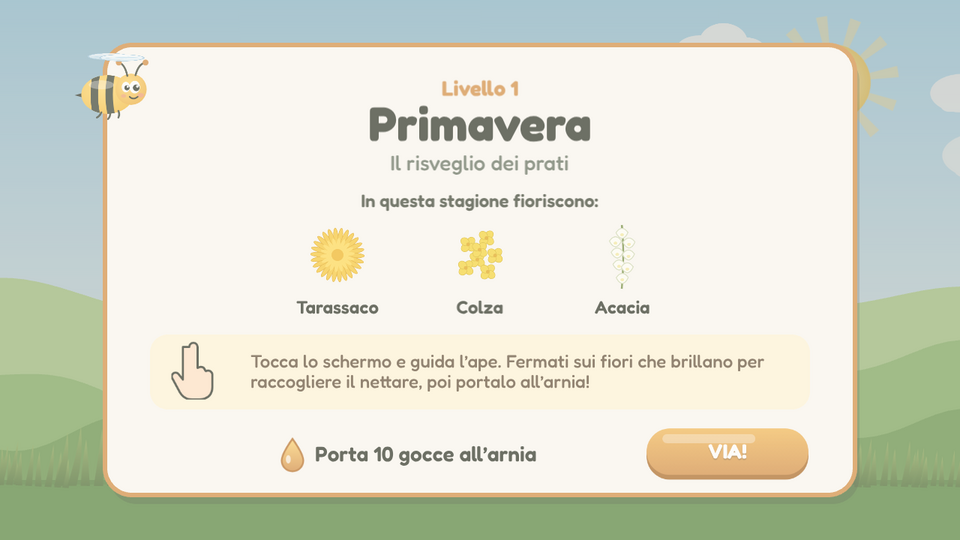
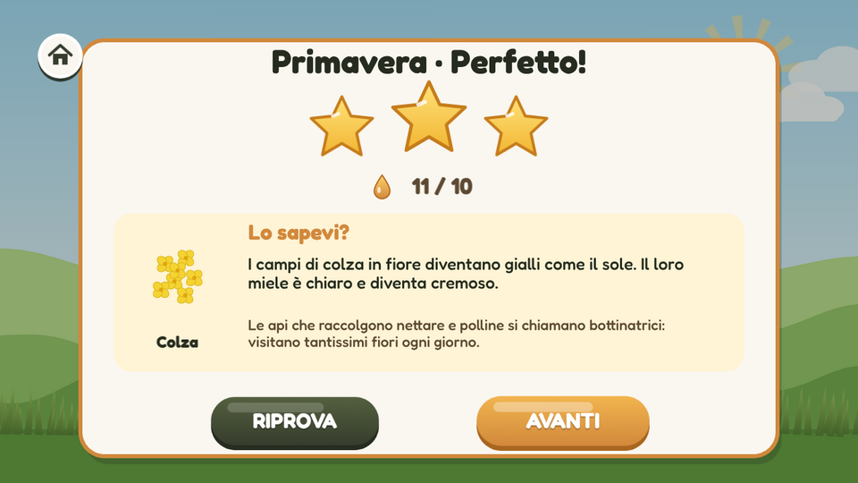
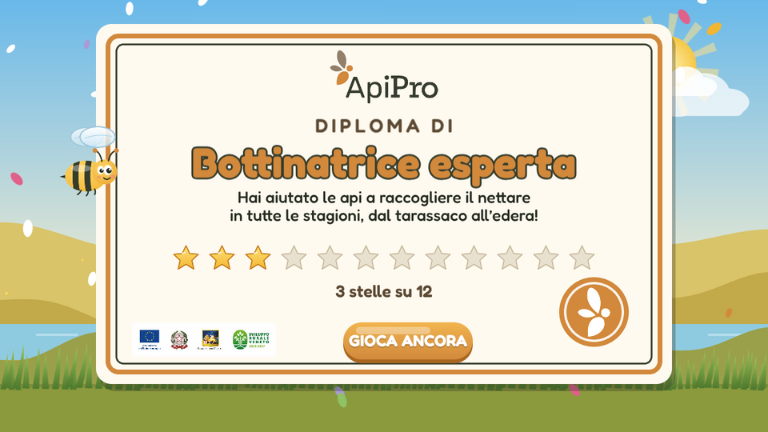

<p align="center"></p>

# Il volo della bottinatrice

**Gioco educativo per bambini (6–10 anni) sulle api e sulle fioriture mellifere del Veneto.**
Fa parte delle attività di divulgazione del progetto **ApiPRO** (PEI-AGRI, CSR Veneto 2023–2027). Si gioca dal browser, senza installare nulla, su tablet, telefono (in orizzontale) e computer.

👉 **Gioca:** https://johnnym1986.github.io/apipro-gioco/

<p align="center"></p>

---

## Indice

- [Come si gioca](#come-si-gioca)
- [Le stagioni](#le-stagioni)
- [Cosa impara il bambino](#cosa-impara-il-bambino)
- [Uso durante eventi e visite](#uso-durante-eventi-e-visite)
- [Come è fatto](#come-è-fatto)
- [Librerie e risorse open source](#librerie-e-risorse-open-source)
- [Struttura del repository](#struttura-del-repository)
- [Sviluppo locale e pubblicazione](#sviluppo-locale-e-pubblicazione)
- [Modificare i contenuti](#modificare-i-contenuti)
- [Dati e riservatezza](#dati-e-riservatezza)
- [Crediti e licenza](#crediti-e-licenza)

## Come si gioca

1. Il bambino guida l'ape trascinando il dito sullo schermo (oppure col mouse o con le frecce della tastiera). Sul touch l'ape vola un po' sopra il dito, così non viene coperta.
2. Quando si ferma su un fiore **in piena fioritura**, che brilla, l'ape raccoglie il nettare goccia dopo goccia. Un anello arancione mostra l'avanzamento della raccolta.
3. L'ape porta al massimo **5 gocce**. Quando è piena compare la freccia "Arnia!" e bisogna riportare il nettare all'arnia.
4. Si vince la stagione portando all'arnia le gocce richieste prima del tramonto: il sole che scorre in alto segna il tempo.

<p align="center"></p>

**I fiori hanno un ciclo di vita.** Ogni fiore passa dal boccio alla piena fioritura, poi appassisce e perde i petali, come nella scala F0–F5 del protocollo ApiPRO Fioriture. Il nettare si raccoglie solo nelle fasi giuste, più in fretta in piena fioritura. Ogni fiore ha una quantità limitata di nettare, quindi bisogna spostarsi.

**I pericoli** (dal livello 2):
- il **calabrone asiatico** (*Vespa velutina*) pattuglia il prato e insegue l'ape. Se la tocca, l'ape perde le gocce che sta portando. Vicino all'arnia l'ape è al sicuro;
- la **nuvola di pesticida** (dal livello 3) fa girare la testa all'ape e la rallenta per qualche secondo.

Non esiste il "game over": per un bambino piccolo il gioco resta sempre incoraggiante.

**Stelle:**

| Risultato | Stelle |
|---|---|
| Obiettivo raggiunto con almeno 15 secondi di anticipo | ⭐⭐⭐ |
| Obiettivo raggiunto all'ultimo | ⭐⭐ |
| Almeno il 60% delle gocce allo scadere del tempo | ⭐ |

Con almeno una stella si sblocca la stagione successiva. Finite le quattro stagioni, compare il **Diploma di Bottinatrice esperta**.

## Le stagioni

| # | Stagione | Fiori (dal catalogo ApiPRO Fioriture) | Obiettivo | Novità |
|---|---|---|---|---|
| 1 | Primavera | tarassaco, colza, acacia (robinia) | 10 gocce · 75 s | tutorial guidato alla prima partita |
| 2 | Inizio estate | castagno, tiglio, amorfa, rododendro | 12 gocce · 80 s | calabrone asiatico |
| 3 | Estate | girasole, limonio, astro marino | 14 gocce · 85 s | nuvola di pesticida, laguna con barene |
| 4 | Autunno | edera, astro marino | 14 gocce · 85 s | due calabroni, foglie che cadono |

<p align="center"> </p>

## Cosa impara il bambino

- **Il lavoro della bottinatrice:** raccogliere nettare e portarlo all'arnia, dove diventa miele.
- **Le piante mellifere del Veneto e la loro stagione**, dal tarassaco di inizio primavera all'edera d'autunno. Le specie sono le 11 del protocollo di monitoraggio di ApiPRO.
- **Le fasi della fioritura:** il nettare si trova solo quando il fiore è aperto.
- **Le minacce per le api:** il calabrone asiatico e i pesticidi.
- **Le curiosità "Lo sapevi?"** a fine stagione: una sulla pianta (per esempio il miele di acacia, che resta liquido a lungo, o quello di castagno, scuro e amarognolo) e una sulle api (la danza, i pesticidi, il calabrone).

<p align="center"> </p>

## Uso durante eventi e visite

- Si apre dal link su qualsiasi tablet. Su iPad o Android, *Condividi → Aggiungi alla schermata Home* lo trasforma in un'icona a schermo intero.
- I telefoni in verticale mostrano l'invito a ruotarli in orizzontale.
- Le stelle restano salvate **solo su quel dispositivo**. Per ricominciare da zero tra un gruppo e l'altro basta cancellare i dati del sito dal browser.
- Il gioco va in pausa da solo se si cambia app o scheda. L'audio si spegne col pulsante in alto a destra.
- Ogni partita dura 1–2 minuti, adatta alle rotazioni durante una visita scolastica.

## Come è fatto

- **Motore di gioco:** [Phaser 3](https://github.com/phaserjs/phaser) (v3.90), con TypeScript e [Vite](https://github.com/vitejs/vite). Organizzazione ispirata al template ufficiale [phaserjs/template-vite-ts](https://github.com/phaserjs/template-vite-ts).
- **Grafica:** tutte le illustrazioni (ape, calabrone, arnia, 11 fiori, interfaccia) sono **originali, disegnate in codice come SVG vettoriali** nei colori del brand ApiPRO (`scripts/art.mjs`). Sono nitide su ogni schermo e leggerissime. I fiori riprendono lo stile delle icone della WebApp [ApiPRO Fioriture](https://github.com/JohnnyM1986/apipro-fioriture).
- **Effetti:** particelle di Phaser (polline, scintille, petali, coriandoli), bagliore sui fiori pronti, rimbalzi e "squash & stretch" sui pulsanti, tremolio della camera quando si viene colpiti.
- **Suoni e musica:** generati al momento con [ZzFX](https://github.com/KilledByAPixel/ZzFX), senza file audio da scaricare. La musichetta di sottofondo è un arpeggio pentatonico generato dal codice.
- **Carattere:** [Fredoka](https://github.com/fontsource/font-files/tree/main/fonts/google/fredoka), tondo e leggibile per i bambini, incluso nel sito (nessuna chiamata a Google Fonts).
- **Brand:** logo ApiPRO, simbolo dell'ape e fascia dei loghi istituzionali presi dal brand kit, gli stessi della WebApp Fioriture.

## Librerie e risorse open source

Valutate per il progetto:

| Risorsa | Uso | Licenza |
|---|---|---|
| [phaserjs/phaser](https://github.com/phaserjs/phaser) | motore di gioco 2D (WebGL/Canvas) | MIT |
| [phaserjs/template-vite-ts](https://github.com/phaserjs/template-vite-ts) | impostazione del progetto | MIT |
| [KilledByAPixel/ZzFX](https://github.com/KilledByAPixel/ZzFX) | effetti sonori sintetizzati | MIT |
| [fontsource](https://github.com/fontsource/fontsource) – Fredoka | carattere tipografico | OFL 1.1 |
| [rexrainbow/phaser3-rex-notes](https://github.com/rexrainbow/phaser3-rex-notes) | plugin aggiuntivi (UI, effetti): *non usati*, disponibili per sviluppi futuri | MIT |
| [Kenney](https://kenney.nl) / OpenGameArt | pacchetti grafici CC0: *non usati*, si è preferita una grafica originale coerente col brand | CC0 |

## Struttura del repository

```
apipro-gioco/
├── index.html                 pagina del gioco (+ avviso "gira il telefono")
├── public/
│   ├── assets/art/            illustrazioni SVG generate da scripts/art.mjs
│   └── assets/brand/          logo ApiPRO, ape, loghi istituzionali
├── scripts/art.mjs            disegna tutte le illustrazioni
├── src/
│   ├── main.ts                avvio di Phaser e caricamento del font
│   ├── game/
│   │   ├── data.ts            specie, stagioni, curiosità  ← contenuti modificabili
│   │   ├── audio.ts           suoni e musica (ZzFX)
│   │   ├── backdrop.ts        sfondi delle stagioni animati
│   │   ├── store.ts           salvataggio locale di stelle e audio
│   │   └── ui.ts              pulsanti, pannelli, testi
│   └── scenes/                Boot · Title · Levels · Intro · Play · LevelEnd · Final
└── .github/workflows/         pubblicazione automatica su GitHub Pages
```

## Sviluppo locale e pubblicazione

```bash
npm install
npm run dev        # http://localhost:5173
npm run build      # versione pubblicabile in dist/
node scripts/art.mjs   # rigenera le illustrazioni dopo averle modificate
```

A ogni modifica del ramo `main`, GitHub Actions costruisce il gioco e lo pubblica su GitHub Pages. Per farlo funzionare la prima volta bisogna attivarlo nel repository, da *Settings → Pages → Build and deployment → Source: **GitHub Actions***.

## Modificare i contenuti

Tutti i testi e i parametri sono in `src/game/data.ts`:
- `SPECIES`: nome della pianta e curiosità "Lo sapevi?";
- `LEVELS`: fiori di ogni stagione, gocce da raccogliere, tempo, numero di calabroni e di nuvole di pesticida, colori del paesaggio, consiglio iniziale;
- `BEE_FACTS`: curiosità sulle api.

## Dati e riservatezza

Il gioco non raccoglie dati personali, non usa cookie e non chiama servizi esterni. Nel dispositivo restano salvate solo le stelle ottenute e la scelta dell'audio.

## Crediti e licenza

Gioco realizzato per il progetto **ApiPRO** – Gruppo Operativo PEI-AGRI, CSR Veneto 2023–2027.

Codice e illustrazioni sono distribuiti con licenza **MIT** (vedi [LICENSE](LICENSE)). Il logo ApiPRO e i loghi istituzionali appartengono ai rispettivi titolari e non sono coperti dalla licenza.
